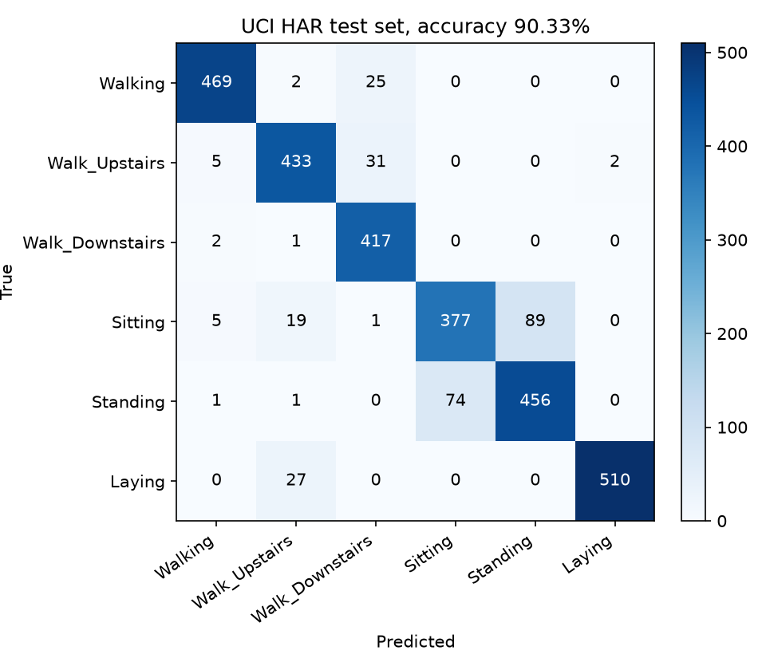

# Phase 1: model

A small 1D CNN trained in PyTorch on the raw inertial signals of the UCI HAR
dataset. This exact network is what later phases quantise to int8 and write by
hand in Verilog, so it is kept deliberately plain.

Every number below was produced by the scripts in this folder and is also in
[`results.json`](results.json).

## Reproduce

From the repository root (Python 3.11):

```sh
python3.11 -m venv .venv
.venv/bin/pip install -r phase1_model/requirements.txt

.venv/bin/python phase1_model/download_data.py   # ~61 MB download into data/ (git-ignored)
.venv/bin/python phase1_model/train.py           # trains seeds 0,1,2 (~100 s on CPU), then runs evaluate.py
.venv/bin/python phase1_model/evaluate.py        # re-evaluate the committed weights.npz only
```

`train.py` is the "one command": it trains, picks a model, and prints accuracy,
parameter count and operation count. Training is deterministic: re-running it
on the same machine reproduced `weights.npz` byte for byte.

## Files

| File | What it is |
|---|---|
| `download_data.py` | Downloads the UCI archive (a zip inside a zip), unpacks it, checks shapes |
| `har_data.py` | Loads the nine raw signal files into `(windows, 9, 128)` arrays |
| `model.py` | The network, plus `.npz` save/load |
| `train.py` | Training, validation-based model selection, weight export |
| `evaluate.py` | Accuracy, confusion matrix, parameters, MACs, batch-1 latency |
| `weights.npz` | Exported float32 weights of the chosen model |
| `results.json` | Measured numbers for `weights.npz` |
| `train_summary.json` | Per-seed validation and test accuracy |
| `confusion_matrix.png` | Confusion matrix plot |

## Data

- 7352 train windows (21 volunteers), 2947 test windows (9 other volunteers), 6 classes.
- Each window is 128 samples x 9 channels, in this order: `body_acc_{x,y,z}`,
  `body_gyro_{x,y,z}`, `total_acc_{x,y,z}`.
- The dataset's official train/test split is used unchanged.
- Validation: train volunteers 7, 15, 22 and 28 (1339 windows) are held out;
  the other 17 volunteers (6013 windows) are used for fitting. The list was fixed
  before any training. The test set is never used to choose anything.
- Each channel is standardised with the mean and standard deviation of the
  fitting windows. These 9 + 9 numbers are stored in `weights.npz`.

## Architecture

| Layer | Input shape | Output shape | Parameters | MACs per window |
|---|---|---|---|---|
| Conv1d 9 -> 8, kernel 5, stride 1, no padding | (9, 128) | (8, 124) | 368 | 44,640 |
| ReLU | (8, 124) | (8, 124) | 0 | 0 |
| MaxPool1d 2 | (8, 124) | (8, 62) | 0 | 0 (496 compares) |
| Conv1d 8 -> 16, kernel 5, stride 1, no padding | (8, 62) | (16, 58) | 656 | 37,120 |
| ReLU | (16, 58) | (16, 58) | 0 | 0 |
| MaxPool1d 2 | (16, 58) | (16, 29) | 0 | 0 (464 compares) |
| Flatten + Linear 464 -> 6 | (464,) | (6,) | 2,790 | 2,784 |
| **Total** | | | **3,814** | **84,544** |

How MACs are counted: one MAC is one multiply feeding an accumulator.
Conv1d = `out_len * out_channels * in_channels * kernel`; Linear =
`in_features * out_features`. Bias additions, ReLU and max-pool comparisons
contain no multiplies and are not counted as MACs.

Hardware-friendly choices: no batch norm, no dropout, ReLU only, kernel size 5,
channel counts 8 and 16, no padding (so no edge cases at the window boundary).
Flatten order is channel-major: `index = channel * 29 + position`.

## Training

Adam, learning rate 2e-3 with cosine decay, weight decay 1e-4, batch size 64,
60 epochs, cross-entropy loss, CPU. For each seed the epoch with the best
validation accuracy is kept. The saved model is the seed with the best
validation accuracy.

## Results

Three seeds, official test set (2947 windows):

| Seed | Best epoch | Validation accuracy | Test accuracy |
|---|---|---|---|
| 0 | 4 | 94.10% | 90.74% |
| 1 | 9 | 95.52% | 89.89% |
| 2 (saved) | 5 | 96.19% | 90.33% |

Test accuracy over the three seeds: mean 90.32%, standard deviation 0.35
points, range 89.89% to 90.74%.

Saved model (`weights.npz`, seed 2): **90.33% test accuracy** (2662 / 2947).

| Class | Accuracy (recall) | Test windows |
|---|---|---|
| Walking | 94.56% | 496 |
| Walking upstairs | 91.93% | 471 |
| Walking downstairs | 99.29% | 420 |
| Sitting | 76.78% | 491 |
| Standing | 85.71% | 532 |
| Laying | 94.97% | 537 |

Confusion matrix (rows = true, columns = predicted):

| | Walk | Up | Down | Sit | Stand | Lay |
|---|---|---|---|---|---|---|
| Walking | 469 | 2 | 25 | 0 | 0 | 0 |
| Walking upstairs | 5 | 433 | 31 | 0 | 0 | 2 |
| Walking downstairs | 2 | 1 | 417 | 0 | 0 | 0 |
| Sitting | 5 | 19 | 1 | 377 | 89 | 0 |
| Standing | 1 | 1 | 0 | 74 | 456 | 0 |
| Laying | 0 | 27 | 0 | 0 | 0 | 510 |



Most of the error is sitting and standing being confused with each other
(163 of the 285 mistakes).

### CPU latency

Batch size 1, one PyTorch thread, timing input standardisation plus the forward
pass for one raw window with `time.perf_counter_ns`: 5000 timed windows after
500 warm-up calls.

- Machine: MacBook Air (Mac16,12), Apple M4, macOS 26.6.2, PyTorch 2.15.0.
- Median 33.9 us, mean 34.0 us, 99th percentile 40.1 us per window.

This is wall-clock time on a laptop with other programs running.
Two other runs of `evaluate.py` on the same machine gave medians of 29.5 us
and 29.7 us, so read it as "about 30 to 34 us".

## Notes and limits

- Validation loss rises after roughly epoch 5 to 10 while training continues
  (the model overfits the 17 fitting volunteers), which is why the best epochs
  are early. Keeping the best-validation epoch handles this; no dropout or
  other regulariser was added.
- Validation accuracy (94 to 96%) is higher than test accuracy (about 90%).
  The validation set is only four volunteers, so it is a noisy guide.
- No architecture or hyperparameter search was run: this is the first
  configuration tried. It met the roughly-90% target, so it was left alone
  rather than tuned further.

## `weights.npz` contents

| Key | Shape | Meaning |
|---|---|---|
| `conv1.weight` | (8, 9, 5) | (out channel, in channel, tap) |
| `conv1.bias` | (8,) | |
| `conv2.weight` | (16, 8, 5) | |
| `conv2.bias` | (16,) | |
| `fc.weight` | (6, 464) | input index = channel * 29 + position |
| `fc.bias` | (6,) | |
| `input_mean` | (9,) | per-channel mean subtracted from the raw input |
| `input_std` | (9,) | per-channel standard deviation the input is divided by |
